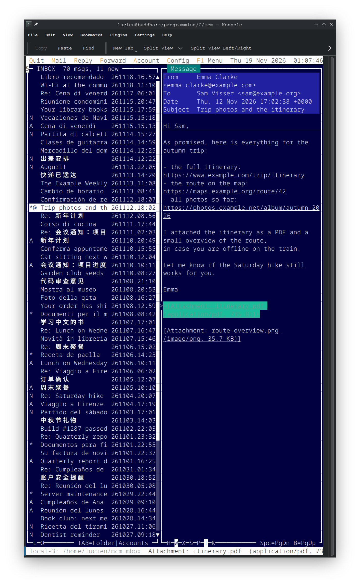
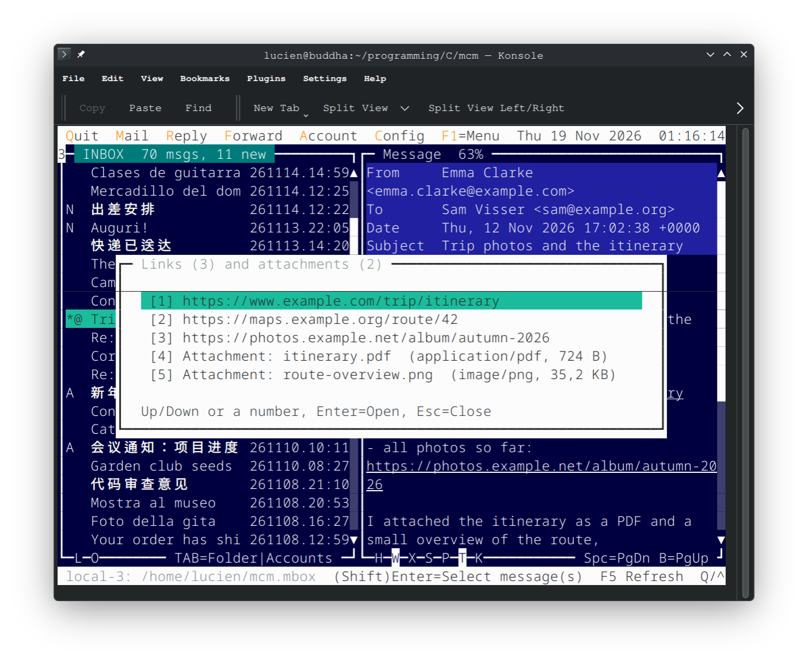
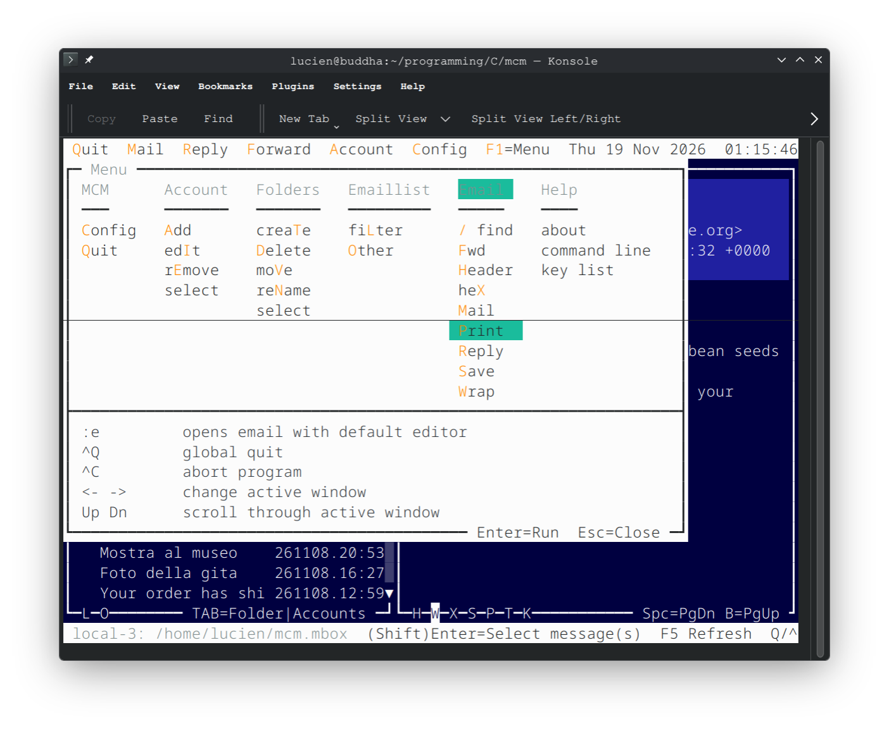
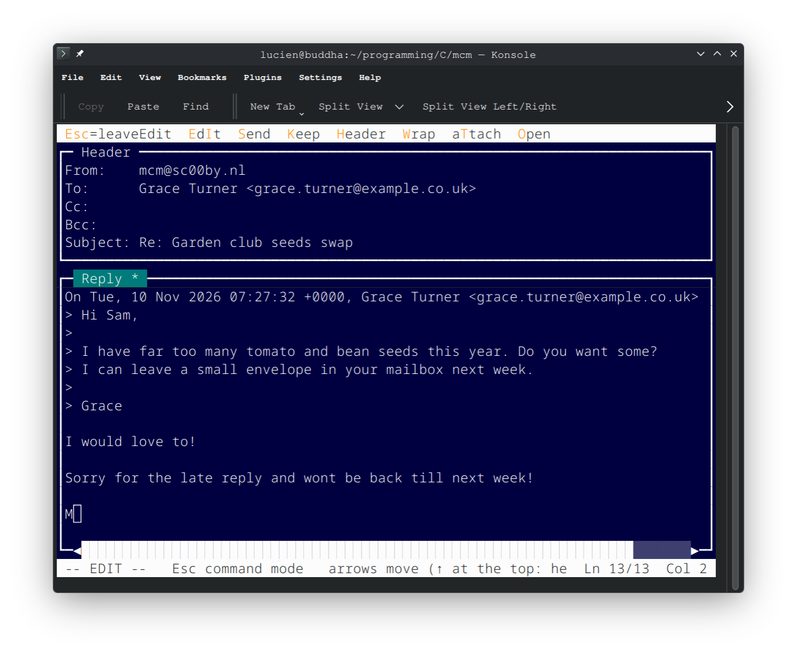
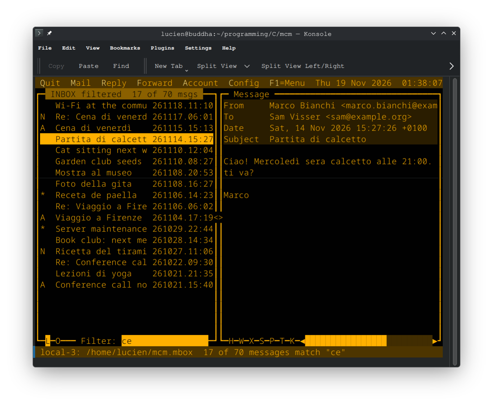
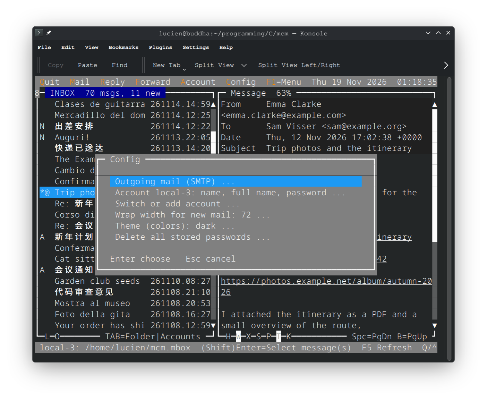
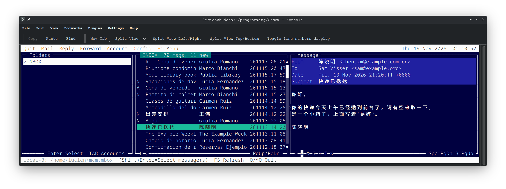

# Mail Commander (mcm)

Mail Commander is a console based email client that supports multiple 
email accounts, and can remember passwords if you choose so, encrypted
with a master password (scrypt + AES-256-GCM).

IMAPS, POP3S, and local mail (Maildir, mbox, MH and sdbox (read only))
are supported.

It is fast with large folders, because it only downloads what is visible
on the screen. It tries to display HTML and Markdown inline. A summary
of all links and attachments is shown at the end of the message.

The interface and navigation are kept as simple as possible. F1 shows 
all shortcuts. Most functions can be accessed direct with a single 
keystroke and mouse selections are supported as well.

Emails can be written with an internal editor. Or edited with an
external editor as defined by $EDITOR as environment variable, or by
`editor` in the config file when $EDITOR is not set. PDF files and web
links can be opened with programs of your choice too (`pdf_viewer`,
`html_viewer`, see [Programs](#programs)).

Mail Commander is written in C, uses ncurses and should work in Linux, 
*BSD and Windows.

Initial layout consists of 2 windows, showing all the messages from a
mail folder on the left and the highlighted message on the right.
F1 explains all shortcuts. TAB and <- and -> cycle through the windows, 
including a window where all mailfolders are listed, and a window
where all known accounts are listed.

```
 Quit  Mail  Reply  Forward  Account  Config  F1=Menu                        Thu 12 Nov 2026
┌─ INBOX  3 msgs, 1 new ──────────────────────┐┌─ Message ──────────────────────────────┐
│A Weekly deals        Newsletter 261112.23:01││From     Newsletter <news@shop.example> ▲
│N Grüße aus Köln      Jürgen M…  261111.09:15││Subject  Weekly deals                   █
│  plain old mail      alice@ex…  261111.00:00││                                        ░
│                                             <>Hello,                                  ▼
└─L─O──────── TAB=Folder|Accounts  PgUp/PgDn ─┘└─H─W─X─S─P─T─K───────── Spc=PgDn B=PgUp ─┘
 test@localhost  (Shift)Enter=Select message(s)  F5 Refresh  Q/^Q Quit
```

## Screenshots

All messages in these screenshots are made-up examples.

| | |
|:---:|:---:|
| [](screenshots/message-tall.png)<br>Message list and message, with links and attachments (default theme) | [](screenshots/links-attachments.png)<br>All links and attachments of a message (K) |
| [](screenshots/menu.png)<br>The F1 menu | [](screenshots/editor-reply.png)<br>Writing a reply in the built-in editor |
| [](screenshots/filter-amber.png)<br>Filtering the list (L), amber theme | [](screenshots/config-dark.png)<br>The Config menu, dark theme |

[](screenshots/wide-three-windows.png)<br>
On a wide terminal mcm shows folders, messages and the message side by side.

## Getting the source

The source is on GitHub: <https://github.com/Luke1970/mcm>. With git:

```sh
git clone https://github.com/Luke1970/mcm.git
cd mcm
```

Later, `git pull` in that directory fetches the newest version (then run
`make` again). Without git, download it as a zip file: on the GitHub page
choose **Code → Download ZIP**, or

```sh
curl -LO https://github.com/Luke1970/mcm/archive/refs/heads/main.zip
unzip main.zip && cd mcm-main
```

A ready-made Windows version is at <https://sc00by.nl/lucien/mcm/mcm.zip>.

## Build

What mcm needs on every system:

- **GNU make** (`make` on Linux, `gmake` on the BSDs), a C compiler (GCC or
  Clang), `pkg-config` and `awk`;
- **ncurses** with wide characters (`ncursesw`). Version 6.1 or later gives
  24-bit color; older versions work with 256 colors;
- **OpenSSL** 1.1.1 or 3.x, or **LibreSSL** (OpenBSD);
- **iconv**: part of the C library on Linux, FreeBSD and NetBSD; a package on
  OpenBSD.

`make` finds the libraries with `pkg-config` and knows where each BSD keeps
its packages. `make install` puts `mcm` in `$(PREFIX)/bin` and the themes
in `$(PREFIX)/share/mcm/themes` (`PREFIX` is `/usr/local` unless you give
another one, e.g. `make install PREFIX=$HOME/.local`); `make uninstall`
removes them. Library flags can be overridden, e.g.
`make CURSES_LIBS="-lncursesw -ltinfo"`.

### Linux

| Distribution | Libraries and tools |
|---|---|
| Fedora, RHEL, Rocky, Alma | `sudo dnf install gcc make pkgconf-pkg-config ncurses-devel openssl-devel` |
| Debian, Ubuntu, Mint | `sudo apt install build-essential pkg-config libncurses-dev libssl-dev` |
| Arch, Manjaro | `sudo pacman -S --needed base-devel ncurses openssl` |
| openSUSE | `sudo zypper install gcc make pkg-config ncurses-devel libopenssl-devel` |

Then, in the mcm directory:

```sh
make
sudo make install
```

### FreeBSD

OpenSSL and iconv are part of the base system; ncurses, GNU make and
pkg-config come from packages (in `/usr/local`). As root:

```sh
pkg install gmake pkgconf ncurses
```

Then, in the mcm directory:

```sh
gmake
su root -c 'gmake install'
```

### OpenBSD

ncurses and LibreSSL are part of the base system; GNU make and iconv come
from packages. LibreSSL has no scrypt, so mcm uses its own; it gives the same
keys as OpenSSL's, so stored passwords stay readable on other systems.
Tested on OpenBSD 8.0 (amd64): build, install, IMAPS login, certificate
check, stored passwords and the keys. As root:

```sh
pkg_add gmake libiconv
```

Then, in the mcm directory:

```sh
gmake
doas gmake install
```

### NetBSD

OpenSSL and iconv are part of the base system. NetBSD's own curses has no
mouse support or extended colors, so mcm uses ncursesw from pkgsrc (in
`/usr/pkg`). As root:

```sh
pkgin install gmake pkgconf ncursesw
```

Then, in the mcm directory:

```sh
gmake
su root -c 'gmake install'
```

The FreeBSD and NetBSD instructions follow each system's packages but have
not been tried yet. If a library is not found, give its flags to gmake as
shown above.

### Windows 10 and 11

The Windows version is cross-compiled on Linux with MinGW-w64 into one
`mcm.exe` with everything built in: PDCurses (instead of ncurses), OpenSSL,
zlib and win-iconv. PDCurses is compiled from its source with the same
settings as mcm. On Fedora:

```sh
sudo dnf install mingw64-gcc mingw64-openssl-static mingw64-zlib-static mingw64-win-iconv-static
curl -LO https://github.com/wmcbrine/PDCurses/archive/refs/tags/3.8.tar.gz
tar -xzf 3.8.tar.gz
make win PDCURSES=PDCurses-3.8
```

The result is the folder `win/mcm/` with `mcm.exe` and `themes\`, also
packed as `win/mcm.zip` when `zip` is installed. How to install and use it:
see [Windows](#windows).

### MS-DOS

mcm itself does not run on MS-DOS yet (see [MS-DOS](#ms-dos-planned)). What
builds is the TLS benchmark in `dos/`, which measures BearSSL on a real or
emulated PC:

- `dos/BENCH.EXE` - 16-bit, runs on any PC from the 8088 up (MS-DOS 3.3 or
  later, or FreeDOS);
- `dos/BENCH32.EXE` - 32-bit, needs a 386 or later (the DOS/32A extender is
  built in; no 387 needed).

They are cross-compiled on Linux with:

- **Open Watcom v2** - <https://github.com/open-watcom/open-watcom-v2/releases>,
  the `Current-build` release, file `ow-snapshot.tar.xz`;
- **BearSSL 0.6** - <https://bearssl.org/>, file `bearssl-0.6.tar.gz`, patched
  with `dos/bearssl-0.6-16bit.patch` (two changes that 16-bit compilers need).

Download, unpack and patch (here in `~/dos`), then build from the mcm directory:

```sh
mkdir -p ~/dos/watcom && cd ~/dos
curl -LO https://github.com/open-watcom/open-watcom-v2/releases/download/Current-build/ow-snapshot.tar.xz
tar -xJf ow-snapshot.tar.xz -C watcom
curl -LO https://bearssl.org/bearssl-0.6.tar.gz
tar -xzf bearssl-0.6.tar.gz
cd bearssl-0.6 && patch -p1 < /path/to/mcm/dos/bearssl-0.6-16bit.patch
cd /path/to/mcm
make dos-bench WATCOM=$HOME/dos/watcom BEARSSL=$HOME/dos/bearssl-0.6
```

Copy `BENCH.EXE` or `BENCH32.EXE` to the DOS machine and run `BENCH FAST`
(or `BENCH32 FAST`); without `FAST` it also times the slower alternative
implementations. The results are shown and written to `RESULT.TXT`.

### Help texts

The help texts are plain text files in `help/`; edit them and run `make`:

| File | Shown |
|---|---|
| `help/cmdline.txt` | `mcm --help` / `mcm -h` |
| `help/usage.txt` | after a wrong command line option |
| `help/keys.txt` | the Key list window: ? in mcm, or Help > Key list in the menu |
| `help/editor.txt` | the key line at the bottom of the editor (one line) |

Lines starting with `#` are comments, `@VERSION@` becomes the version number.
The build turns the files into `src/helptext.h` (with `tools/txt2c.awk`).

## Usage

```
mcm [-a account | -n] [-s server] [-p port] [-u user] [-t theme] [-f URL]
mcm [options] URL
mcm -h | --help
```

`mcm --help` explains the options and every kind of mail (IMAP, POP3, Maildir,
mbox, MH, a directory of folders) with examples.

`-a NAME` starts with that account (a new one if the name is unknown), `-n`
sets up a new account. A server/user from the command line or URL picks the
account with that user and server, or makes a new one. Without any of these,
mcm uses the only account, or lets you choose when there are several.

Where the mail is can also be given as one URL, after `-f` or on its own:

```sh
mcm -f imaps://me@example.com@imap.example.com
mcm imaps://me@imap.example.com:993/Archive/2025
mcm pop3s://me@pop.example.com
mcm ~/Maildir
mcm -f mbox:/var/spool/mail/me
mcm ~/Mail/inbox             # an MH folder
mcm ~/Mail                   # a directory of folders
```

The user may be an e-mail address (the last `@` ends it; `%40` also works).
Port defaults to 993 for IMAP and 995 for POP3, the folder to INBOX. Only
`imaps://` and `pop3s://` are accepted (never unencrypted), and a password in
the URL is refused. A path (starting with `/`, `~` or `.`, or written as
`file://`, `maildir:` or `mbox:`) opens local mail.

A new account first asks where the mail is:

| Type | Mail | Folders |
|---|---|---|
| **IMAP** | stays on the server (IMAPS) | all on the server |
| **POP3** | INBOX is read from the server (POP3S); messages are **left on the server** | Sent, Drafts and other folders are local |
| **Local** | Maildir or mbox on this computer | all local |

For IMAP and POP3 a login dialog asks for the account name, your full name,
server, port (993 IMAP, 995 POP3), user and password, with the cursor on the
first empty field.
When the password of the account is stored (see below), only the master
password is asked.

The server certificate is checked against the system's trusted certificates and
the server name. If that fails (self-signed, expired, wrong name, ...) mcm shows
the certificate's details and SHA-256 fingerprint and lets you **Reject** it,
**Accept once** (this session) or **Always accept** it. Always-accepted
certificates are stored as `host port fingerprint` in `~/.config/mcm/certs`;
if such a server later presents a different certificate, mcm warns that it has
changed. Automatic reconnects only accept the certificate accepted at login.

### POP3

POP3 only knows one mailbox, so a POP3 account shows the server's INBOX next to
local folders: Sent and Drafts are Maildirs in `~/.local/share/mcm/NAME/`
(`path =` in the account to put them elsewhere), created when first used.

- **Encryption:** port 995 (and any port other than 110) uses TLS from the
  start. Port 110, or a server that greets in plain text, must offer **STLS**;
  mcm refuses to log in otherwise, so the password never goes unencrypted.
- **Seen and answered:** POP3 has no flags, so mcm keeps them per message
  (by its UIDL, the server's unique id) in `.mcm-pop3-state` in the local
  folder directory. Messages no longer on the server are forgotten there.
- **New mail:** a POP3 session only sees the mailbox as it was at login. mcm
  starts a new session on **F5** and otherwise every 5 minutes; in between it
  keeps the session alive.
- Headers for the list are read with TOP; a message is downloaded whole (RETR)
  when you open it. Nothing is deleted on the server.

### Local mail

A local account reads Maildir, mbox and MH folders. Its dialog asks for the account
name, full name, e-mail address (for From: when you send) and the path:

- an **mbox file**, e.g. `/var/spool/mail/me`: one folder, INBOX;
- a **Maildir** (with `cur/ new/ tmp/`), e.g. `~/Maildir`: INBOX, plus Maildir++
  subfolders (`.Archive`, `.Lists.foo`, names in IMAP's modified UTF-7);
- an **MH folder** (numbered message files `1`, `2`, ... and `.mh_sequences`),
  e.g. `~/Mail/inbox`: INBOX, its subdirectories are subfolders;
- a **directory**, e.g. `~/Mail`: every mbox file, Maildir and MH folder under
  it is a folder (subdirectories nest), and `$MAIL` is INBOX if none is found.

The default path is the first of `~/Maildir`, `~/Mail`, `~/mail`, `$MAIL`.
Sent and Drafts are listed even before they exist; the first message saved
there creates them, of the kind most folders there are (Maildir, mbox or MH).

Flags: in a **Maildir** they are kept in the file names (S seen, R answered,
F flagged, T deleted), and reading a message moves it from `new/` to `cur/`, as
other mail programs expect. **MH** keeps them in the `unseen`, `replied` and
`flagged` sequences of `.mh_sequences` (rewritten as a new file; other sequences
such as `cur` are kept), and a saved message gets the next free number. An
**mbox** file is only read and appended to (with `fcntl` locking and mboxrd
`>From ` quoting): its `Status`/`X-Status` headers give the flags, and messages read in mcm count as seen until it exits.
Changes by other programs (new mail delivered, messages removed) are picked up
on F5 and every minute.

Sending from a local account uses its SMTP settings (**C** → SMTP); without
a password there, mcm asks for one when sending.

### Accounts

Every account is kept in `~/.config/mcm/mcm.conf` (mode 0600) in its own
section:

```
theme = default
wrap_width = 72
message_wrap = 1
folders_width = 0
list_width = 45
accounts_width = 0
editor = nano
pdf_viewer = zathura
html_viewer = firefox --new-tab
last_account = Work
master_check = enc1$16$8$1$...

[account Work]
type = imap
full_name = Jörg Tester
server = imap.example.org
port = 993
user = joerg
smtp_server = smtp.example.org
smtp_port = 587
smtp_user = joerg
smtp_login = joerg@imap.example.org
store_password = yes
password = enc1$16$8$1$7tWK5raqq4hb0Rj84KmwWQ==$FFn/udLX4L5p4vH9$2HsX...

[account Home]
type = pop3
server = pop.example.net
port = 995
user = me@example.net
path = /home/me/.local/share/mcm/Home

[account Archive]
type = local
address = me@example.net
path = ~/Mail
```

`type` is `imap` (the default), `pop3` or `local`.

The full name goes into From: as `Jörg Tester <joerg@example.org>`; it is quoted
or RFC 2047 encoded when needed. **A** (Account) lists the accounts: Enter on the
current one (marked `*`) changes its name, full name and stored password; Enter
on another one, or on *New account*, switches to that account. A config
file from emsg 0.3 (the old name, without sections) is read as one account.

### Programs

Five settings in `mcm.conf` choose the programs mcm starts. Empty (the
default) means the usual choice:

| Setting | Used for | When empty |
|---|---|---|
| `editor` | `:e` in the message window (view the message) and in the mail editor (edit the text) | `vi` (Windows: Notepad) |
| `pdf_viewer` | opening a PDF attachment (**K** then Enter) | the desktop's program (`xdg-open`; Windows: the program Windows uses) |
| `html_viewer` | opening an http, https or ftp link (**K**, or Enter on a link) | the desktop's browser (`xdg-open`) |
| `pdf_viewer_console` | the same as `pdf_viewer`, without X or Wayland | the first installed of `fbpdf`, `jfbview`, `fbgs` (pages on the Linux framebuffer), else `pdftotext -layout %s - \| less` (the text only) |
| `html_viewer_console` | the same as `html_viewer`, without X or Wayland | the first installed of `w3m`, `lynx`, `elinks`, `links`, `links2` |

mcm chooses between the two by `$DISPLAY` and `$WAYLAND_DISPLAY`: when one
of them is set there is a graphical desktop (also in a terminal window on
it), otherwise mcm runs on a text console, over ssh or in a plain tty.
`mcm --programs` shows which it finds and which programs it would use:

```
$ mcm --programs
Environment: console, no X or Wayland (TERM=linux)
Editor:      vi
PDF:         pdftotext -layout %s - | less (default)
Web links:   w3m (default)
```

`editor` is only used when the environment variables `$VISUAL` and
`$EDITOR` are not set (for example in `~/.bashrc`): those come first.
A command may have arguments; the file or link is added at the end, or
put where `%s` is (the command is then a shell command line, so a pipe
works):

```
editor = nano -w
pdf_viewer = evince
html_viewer = firefox --new-tab
pdf_viewer_console = pdftotext -layout %s - | less
html_viewer_console = w3m
```

Console programs (w3m, lynx, links, elinks, browsh, less, vi, vim, nano and
a few more) run in the terminal: mcm steps aside and comes back when they
end. Other programs are started next to mcm, which keeps running; without
a graphical desktop every program runs in the terminal, `xdg-open` for
other attachments too. `mailto:` links always go to the desktop's mail program.
HTML attachments are still never opened (scripts in them would run), only
saved.

There is no dialog for these settings: edit `mcm.conf` while mcm is not
running (mcm writes the file when it ends).

### Stored passwords

After the first successful login mcm asks whether to store the password:
**Store encrypted**, **Not now** (ask next time) or **Don't ask again**. A stored
password is encrypted with a *master password* that you choose once (typed
twice, at least 8 characters). After that, mcm asks for the master password
once, at start, instead of the account password; Esc skips it and shows the
normal login. Switching to another account does not ask it again.
The master password and the decrypted passwords are only kept in memory and
are overwritten when mcm exits. **A** can store or forget the password later;
**C** (Config) → *Delete all stored passwords* removes them from every account,
together with the master password check, so you can choose a new master password.
An SMTP password typed under **C** → *Outgoing mail* is stored the same way when the account
stores its password.

How a password is encrypted (`src/vault.c`, OpenSSL):

1. **Key:** `scrypt(master password, salt, N = 2^16, r = 8, p = 1)` gives a
   256-bit key. scrypt needs 64 MiB of memory and about 0.1 s per try, which
   makes guessing the master password slow, also on GPUs. The salt is 16 random
   bytes, new for each stored value, so equal passwords never look the same.
2. **Encryption:** AES-256-GCM with a random 12-byte nonce. GCM also
   authenticates: a wrong master password or any changed byte makes decryption
   fail instead of giving a wrong password.
3. **Bound to the account:** the text `imap USER@SERVER` (or `smtp USER@SERVER`)
   is authenticated with it (GCM additional data). If someone changes
   `server =` in the config file, the stored password no longer decrypts, so it
   cannot be sent to another server: mcm says so and asks for the password.
4. **Stored as** `enc1$16$8$1$SALT$NONCE$CIPHERTEXT+TAG` (base64): version,
   scrypt parameters (log2 N, r, p), salt, nonce, and the encrypted password
   with its 16-byte GCM tag.
5. **Checking the master password:** `master_check` holds the word `emsg`
   (the program's old name, kept so existing master passwords still work)
   encrypted the same way, so a wrong master password is reported at once.

The protection is as strong as the master password: someone with a copy of
`mcm.conf` can try master passwords offline, each try costing the scrypt work.
Use a long one. The master password itself is never stored.

### Screen and keys

There are four windows: **Accounts**, **Folders**, the **email list** and the
**message**. The message is always on the right.

- **Up to 150 columns** two are shown. **Tab** changes the left window in
  turn: email list → Folders → Accounts → email list (Shift-Tab goes the
  other way). Each window's bottom border shows where Tab | Shift-Tab go:
  `TAB=Folder|Accounts` in the email list, `TAB=Account|Email` in Folders and
  `TAB=Email|Folder` in Accounts (after `Enter=Select` when the window is wide
  enough). Opening a folder (Enter) brings the email list back.
- **151 to 170 columns** three are shown side by side: Folders (or
  Accounts) | List | Message. Tab switches the first window between Folders
  and Accounts.
- **More than 170 columns** all four are shown: Accounts | Folders | List |
  Message. Tab is not needed then and does nothing, and no window shows a
  `TAB=` hint; ← and → walk through all four.
- A window left of the message is never narrower than 25 columns.

The date in the email list depends on the number of windows:

| Windows | Today | Before today |
|---|---|---|
| two (up to 150 columns) | `14:25` | `Nov18` |
| three or four (over 150 columns) | `Thu 2026Nov19 14:25` | `Wed 2026Nov18 09:10` |

Days and months are always in English, so the column keeps the same width
in every language.

The **Accounts** window is 25 columns wide and the **Folders** window a
quarter of the screen, but at most 35 columns, unless you change them
(Ctrl-← / Ctrl-→ or dragging a border). In `mcm.conf` that default is
`accounts_width = 0` and `folders_width = 0`.

The **Accounts** window lists every account (the current one marked `>` and
in bold) with where its mail is, and *New account ...* at the end. Enter or
a double click on the current account shows its folders; on another account
mcm switches to that one (as **A** does), on *New account* it sets up a new
one; if that login is cancelled or fails, the previous account is opened
again. → or Esc goes to the email list.

← and → move between the windows; on the main screen Esc goes back to the email
list. On startup INBOX is opened and the newest message is shown.

The widths can be changed: **Ctrl-←** / **Ctrl-→** move the border on the left of
the message (with three or four columns: the border right of Folders or
Accounts when that window has focus), or
drag a border with the mouse (the one between list and message is marked `<>`):
it follows the mouse while the button is held. (Only during such a drag does
mcm ask the terminal for mouse movement, xterm mode 1002; otherwise it
receives clicks only.) The widths are kept in `mcm.conf` as percentages, so
they also fit after the terminal is resized: `folders_width` is the folder
window's share of the screen (0, the default: 25 %, at most 35 columns;
25 from an older mcm counts as 0), `list_width` the email list's share of the
screen (with three or four columns: of what the windows left of it leave),
and `accounts_width` the Accounts window's share (0, the default: 25
columns; 15 from an older mcm counts as 0).

| Key | Action |
|---|---|
| Tab, Shift-Tab | up to 150 columns: the left window goes email list → Folders → Accounts → email list (Shift-Tab: back); 151–170 columns: the first window switches between Folders and Accounts; wider: nothing (all four windows are shown) |
| ← → | move between the windows: ← goes message → email list → Folders → Accounts, → back; in the message with W off they move the text sideways (8 columns), and ← at the start goes to the window on the left |
| ↑ ↓ Home End | move / scroll |
| PgUp PgDn | page through the message list (only there) |
| Enter | open account / folder; in the email list: select the message (or unselect it) and go to the next one |
| Shift-Enter | select from the last message Enter selected to this one (terminals that report Shift-Enter: kitty, foot, WezTerm, xterm with `modifyOtherKeys`; elsewhere it is Enter) |
| Shift-↑ Shift-↓ | select the message and the one above / below |
| O | the selected messages in a window of their own: copy, move, delete (see *Selected messages*) |
| U | undo the last copy, move or delete to Deleted Items (asks first; see *Selected messages*) |
| Esc | in the email list: leave the filter, else clear the selection |
| Space | page down in the message, from every window |
| Shift-Space, Ctrl-Space, Alt-Space, Backspace | page up in the message, from every window |
| B | page up in the message (in the message window) |
| : | a vim-like command in the message window (see below) |
| H | toggle full headers |
| W | wrap long lines in the message (at the window, at most 76 columns) or not (scroll sideways); also turns H and X off |
| X | toggle hex dump of the raw message |
| S | save the message as a text file (see below) |
| P | print the message (`lp`; on Windows Notepad prints it) |
| T | the plain-text version of the email exactly as the sender wrote it, instead of mcm's choice (see *HTML and Markdown messages*); inverted on the message border while on, off again when you open another email |
| K, or Enter / a number in the message window | the message's links and attachments: choose one, Enter opens the link in your browser, or opens / saves the attachment (see below); K on the message border is inverted when the email has links or attachments, and an email with attachments has `@` in the list |
| ↑ / ↓ | in the message window: to the previous / next link or attachment on the screen (underlined; the chosen one between `>` and `<`), else scroll a line; Enter opens the link or asks Open / Save for the attachment, Esc leaves it; a mouse click on one does the same |
| L | filter the email list (see *Filter*) |
| → | from the email list: to the message window |
| F5 | refresh folder (also polled every 60 s) |
| F1, F10 | the menu: every command in one window (see *Menu* below) |
| ? | the key list (help) |
| Q | quit |
| Ctrl-Q, Ctrl-C | quit at once, from anywhere: the main screen, any dialog or the editor (see below) |
| M R F | Mail / Reply / Forward: opens the editor |
| C | Config: SMTP settings, account settings, switch account, wrap width, theme, delete all stored passwords |
| Ctrl-← / Ctrl-→ | narrower / wider left column |
| A | accounts: switch, add, name, full name, stored password |
| mouse | click an email or folder to select it, double-click to open it; click a menu bar item to run it; click L, O or U on the list's or H, W, X, S, P, T, K on the message's bottom border; drag the column border to resize; use a scroll bar (every window that needs one, the help window too, and a horizontal one under an unwrapped message); the wheel scrolls the message, the lists and the help |

The bottom border of the list and the message window shows their paging keys.
The list's bottom border starts with **L** (the filter, inverted while it is
on), **O** (the selected messages, inverted while there are any) and, while
the last copy or move can be undone, **U**. An email with an attachment has **@** after its N/A flag in the list. The message window's bottom border starts with **H W X S P T K**: all headers,
wrapped lines, hex dump, save, print, plain text, links and attachments; H, W, X and T are inverted while their mode
is on, K while the open email has links or attachments, and a click on a letter works like the key. Pressing W also turns H and
X off, back to the message text. With W on (the default, kept in `mcm.conf` as
`message_wrap`) long lines are wrapped at the window's width, at most 76
columns. With W off lines are shown whole: ← and → move the text sideways and
a horizontal scroll bar on the bottom border shows where you are (it replaces
the paging hint while it is there).

**K** shows the links of the open message in a window. HTML and Markdown
messages show their links as numbers (`tweede [2]`) and list them under
**Links:** at the end; web addresses written out in the text
(`https://...`) are added after them, with the next numbers. Choose one with
↑/↓ or by typing its number (the number typed shows on the window's border),
and **Enter** opens it in the desktop's browser (`xdg-open`; on Windows the
default browser); `mailto:` links go to the desktop's mail program. In the
message window, **Enter** opens the links window too, and typing a number
opens it with that link chosen: `12` Enter opens link 12.

The same window lists the message's attachments after the links, numbered on
from the last link (`[3] Attachment: report.pdf  (application/pdf, 120 kB)`).
Choosing one asks **Open** or **Save**: Open shows it in the desktop's
program for that kind of file, Save puts it in `~/Downloads` (see
*Attachments* below).

You can also choose a link in the text itself. Every link that can be
chosen is underlined, as under a mouse pointer. In the message window
**↓** goes to the next link while there is one on the screen, and scrolls a
line when there is none; **↑** does the same upwards. So ↓ walks over the
links on the screen and then reads on. The chosen link is shown between `>`
and `<` in the highlight color (`tweede >[2]<`, `>https://example.org/pad<`),
and the status line shows where it goes (`Link: https://...   Enter=Open
Esc=Leave`). **Enter** opens it; without a chosen link on the screen Enter
opens the links window. **Esc** leaves the link (a second Esc goes back to
the email list), and a link scrolled off the screen is left too. Only `http`,
`https`, `ftp` and `mailto` links are opened; a link in a mail never opens
a local file or runs a program. The rest of a long message is loaded first.

The `[Attachment: name  (type, size)]` lines in the text work the same way:
they are underlined, ↑/↓ stop at them too, and the status line shows
`Attachment: ...   Enter=Open/Save  Esc=Leave`. **Enter** asks Open or Save,
as T does. With the mouse, a **click** on a link opens it, and a click on an
attachment asks Open or Save.

**S** saves the open message as a text file, as it is shown (with all headers
when H is on), in `~/Downloads`, or in your home folder when there is no
`Downloads` (on Windows `%USERPROFILE%\Downloads`). The name is
`mcm--SENDER--YYYY-MM-DD--SUBJECT.txt`: the sender's address, the date from
the message's `Date` header and its subject, e.g.
`mcm--jan@example.com--2026-11-14--Meeting notes.txt`. Characters that are
not allowed in file names (`/ \ : * ? " < > |`) become `_`; an existing file
is never overwritten (`-2`, `-3` is added). The file is readable by you only
(mode 0600). The rest of a long message is fetched first. **P** sends the
same text to the printer with `lp` (CUPS); on Windows Notepad prints it on the
default printer.

The attachments in the **K** window show name, type and size. Names are
decoded in both encodings mail programs use for names that are not plain
ASCII: RFC 2047 (`=?UTF-8?B?...?=`) and RFC 2231 (`filename*=UTF-8''%C3%A9...`,
also split in parts as `filename*0*`, `filename*1`, ...). Choose one with
the arrows and Enter, then **Open** or **Save**:

- **Open** shows it in the program your desktop uses for that kind of file
  (`xdg-open`; on Windows the program Windows uses). mcm writes it to a
  private folder first (`$XDG_RUNTIME_DIR/mcm-attachments`, else
  `~/.cache/mcm-attachments`; on Windows `%TEMP%\mcm-attachments`), which is
  emptied when mcm ends and starts. Files that can run code are never
  opened, only saved: programs and scripts (`.exe`, `.bat`, `.js`, `.sh`,
  `.desktop` and the like), web pages (`.html`, `.svg`: the browser would
  run their scripts), Office files with macros (`.docm`, `.xlsm`, `.pptm`)
  and Windows types used in attacks (`.chm`, `.msc`, `.one`, `.vhd` ...).
  The check uses the name as it is saved, so `invoice.exe ` (with a
  trailing space) counts as `.exe`.
- **Save** puts it in `~/Downloads` (or your home folder) under its own name,
  without overwriting (`-2`, `-3` is added) and readable by you only.
  Folder parts in the name are removed and a leading dot becomes `_`.

Text-direction controls (U+202E and the like) are shown as `?` and become `_`
in file names: they could make `x<U+202E>fdp.exe` look like `xexe.pdf`.

On IMAP only the chosen attachment is downloaded.

Every window whose content does not fit (a long message, a folder with more
emails than rows, many folders or accounts) gets a scroll bar in its right
border: click ▲ or ▼ to scroll a line, click the track above or below the
thumb (█) to scroll a page, or drag the thumb; in a folder of 250,000 emails
that jumps straight to the right place. The mouse wheel over the message
window scrolls it three lines at a time, and over the email list, Folders or
Accounts it scrolls that list. A list scrolled with the wheel or the scroll
bar keeps its selection (the open email stays open); the next key (or click)
brings the list back to the selection. Where the email list has a scroll
bar, the `<` of the `<>` border mark gives way to it. A click on an email or folder selects it (and gives that window
the focus); a double click opens it, like Enter.
Many terminals (GNOME Terminal, Konsole, tmux, the Linux text console) send the
same code for Shift-Space as for Space, so there Shift-Space pages *down*; use
Ctrl-Space, Alt-Space or Backspace to page up. Terminals that report
Shift-Space separately (kitty, or xterm with `modifyOtherKeys`) page up.

**Ctrl-Q and Ctrl-C always quit** (lower or upper case is the same key),
wherever you are (main screen, dialogs, help, file picker, editor), without
questions: connections are closed without waiting for the server, and a message
you were writing is saved as a text file (`~/.local/share/mcm/unsent-DATE.txt`,
mode 0600, its path is printed).

- **Ctrl-Q** is read as a key: mcm switches the terminal's XON/XOFF flow control
  off while it runs (so Ctrl-Q and Ctrl-S reach it) and restores it at exit.
- **Ctrl-C** arrives as a signal, so it also works while mcm waits for the
  network (connecting, TLS, a slow server): the wait stops and mcm quits. If
  that does not happen, a **second Ctrl-C** leaves immediately: the terminal is
  restored, but nothing is saved.
- While `:e` runs your own editor, Ctrl-C belongs to that editor.
- On Windows, Ctrl-C is read as a key like Ctrl-Q (see [Windows](#windows)).

### Menu

**F1** (or **F10**, or a click on `F1=Menu` in the menu bar) opens the menu
window under the menu bar, with every command in six columns:

```
┌─ Menu ───────────────────────────────────────────────────────────┐
│ MCM      Account   Folders   Emaillist   Email    Help           │
│ ───      ───────   ───────   ─────────   ─────    ────           │
│ Config   Add       creaTe    fiLter      / find   about          │
│ Quit     edIt      Delete    Other       Fwd      command line   │
│          export    moVe                  Header   key list       │
│          import    reName                heX                     │
│          rEmove    select                Mail                    │
│          select                          Print                   │
│                                          Reply                   │
│                                          Save                    │
│                                          Wrap                    │
├──────────────────────────────────────────────────────────────────┤
│ :e         opens email with default editor                       │
│ ^Q         global quit                                           │
│ ^C         abort program                                         │
│ <- ->      change active window                                  │
│ Up Dn      scroll through active window                          │
└─────────────────────────────────────────── Enter=Run  Esc=Close ─┘
```

← and → (or Tab) choose the column, ↑ and ↓ the item, and Enter runs it.
The highlighted letter (the capital, or `/` for find) runs its item straight
away from any column, so each letter is used only once. Items in lower case
(select, export, import and the Help column) have no letter: choose them with the arrows. In
the Email and Emaillist columns the letters are the main screen's keys. A
click on an item runs it, and a click outside the window closes it, as do
Esc, F1 and F10. The menu opens again on the column you used last.

Ctrl-M cannot open the menu: a terminal sends Ctrl-M and Enter as the same
code, so mcm cannot tell them apart.

- **MCM**: Config (C); Quit (Q).
- **Account**:
  - Add (A): a new account.
  - edIt (I): the open account's name, full name and stored password.
  - export: writes every folder of the account, or only the folder under the
    cursor in the folders window, into a new Maildir (see
    [Export and import](#export-and-import)).
  - import: copies a Maildir, mbox file or MH folder (or a directory of
    them) into a new folder `Imported-DATE` of the account.
  - rEmove (E): forget another account, with its settings and stored passwords.
    Its mail stays on the server or on disk, and the open account cannot be
    removed.
  - select: go to the accounts window.
- **Folders**: these work on the folder the folders window points at.
  - creaTe (T): asks for a name; `Parent/Name` makes a subfolder, using the
    account's own separator, for example `.` on some IMAP servers. On a
    server that keeps every folder under INBOX, the new folder goes there too.
  - Delete (D): the folder and all messages in it, after you confirm (Cancel is
    the default). A folder with subfolders is refused, and so is INBOX. When
    the folder is open, INBOX is opened first.
  - reName (N): a new name in the same place.
  - moVe (V): puts the folder (with its subfolders) inside another folder or at
    the top level.

  IMAP uses CREATE, DELETE and RENAME; names are sent in modified UTF-7.
  Local folders are made as the kind most folders there are (Maildir, mbox or
  MH). Maildir++ subfolders (`.A.B`) are renamed along with their parent. In
  a directory of folders, a Maildir or mbox file cannot hold subfolders.
- **Emaillist**: fiLter (L), Other: the selected messages (O).
- **Email**:
  - / find: the `:/` search of the message window.
  - Fwd (F), Header (H), heX (X), Mail (M), Print (P), Reply (R), Save (S),
    Wrap (W).
- **Help**: about; command line (the text of `mcm --help`); key list (also ? on the main screen).

### Export and import

**Account > export** saves mail in a Maildir, the format Dovecot, mutt,
Thunderbird (with an add-on) and many other programs read:

- **All folders** or **This folder** (the one under the cursor in the
  folders window).
- mcm asks for a directory, `~/mcm-export-DATE` by default. It must be new,
  or an empty directory. mcm refuses a place inside an existing Maildir or
  inside the mail of a local account, so mail that is already there is never
  changed.
- INBOX goes in the Maildir itself, the other folders become Maildir++
  subfolders (`.Archive`, `.Archive.2025`; names with other than ASCII
  characters in modified UTF-7, as Dovecot writes them). Read, answered,
  flagged and deleted marks are kept in the file names, and each file gets
  the date of its message.
- Sent, Drafts and Deleted Items of a local account are left out until
  they exist (mcm lists them before the first message is saved there).

**Account > import** reads what a local account can read: a Maildir (with
Maildir++ subfolders), an mbox file, an MH folder, or a directory of them.
Everything goes into one new folder of the open account,
`Imported-2026-11-21` (`-2`, `-3` when that exists), with the folders below
it as they were: `Imported-2026-11-21/INBOX`, `Imported-2026-11-21/Archive/2025`.
Read, answered and flagged marks are kept; messages are never marked deleted.
The source is only read.

The structure cannot always be kept, and mcm warns when that happens:

- In a directory of Maildirs or mbox files, a folder cannot hold both
  messages and subfolders. Such a subfolder gets a flat name inside the new
  folder (`Imported-2026-11-21/Archive - 2025`), and mcm lists those at the end.
- When the account cannot have folders inside folders at all, mcm asks first
  and then imports with flat names at the top (`Imported-2026-11-21 - Archive - 2025`).
- A local account that is a single mbox file, and a POP3 account, cannot get
  new folders: mcm says so and imports nothing.

The same from the command line, without the menu: mcm logs in as usual (it
asks for the password when it is not stored), does the work with the
progress window, prints what it did and quits. The exit code is 0 when all
went well, 1 on an error, 2 for a wrong command line. `--export` always
takes every folder; the two cannot be used together.

```
mcm -a Work --export ~/backup/work-2026-11-21
mcm -a Home --import ~/old-mail/Maildir
mcm --import=~/mcm.mbox ~/Mail
```

A folder name with the account's separator in it (`/`, or `.` on some
servers) gets `_` in its place. Both take a while for large mailboxes; a
window shows how far it is, and Esc stops (what was copied so far stays).

### Commands in the message window

With the focus on the message window, **:** opens a vim-like command line on
the bottom line (Enter runs it, Esc cancels). While the message window has
the focus, the bottom line shows a reminder:
`:e Vim  :/text Search  :N Line  :w Save  :q Quit`.

| Command | Does |
|---|---|
| `:e` (`:view`, `:vi`, `:vim`) | open the message, as shown, in `$VISUAL`/`$EDITOR`, else `editor` from mcm.conf (default `vi`, Windows Notepad); vi, vim, nvim and view get `-R` (read only). The temporary file is deleted afterwards |
| `:q` (`:q!`, `:qa`, `:x`, `:wq`) | quit mcm |
| `:w` | save the message as **S** does |
| `:w FILE` | save the message, as shown, to FILE (`~` allowed); `:w! FILE` replaces an existing file |
| `:N`, `:+N`, `:-N`, `:$` | go to line N of the text (headers included, as in `:e`), N lines on or back, the end |
| `:/text`, `:?text` | search on / back, any case, around the end; `:/` repeats. Every match is shown in the highlight color (also in other messages) until `:noh` |
| `:noh` | stop highlighting the search matches |
| `:set wrap`, `:set nowrap`, `:set wrap!` | as **W** |
| `:hardcopy` | print, as **P** |
| `:h` | help |

### Filter

**L** (also at the left of the email list's bottom border) opens a filter bar in
that border: `Filter: text  Enter=Apply  Esc=Leave`. Type a word and press
**Enter**: the list shows only the messages whose **subject or sender**
contains it, ignoring upper and lower case (also for letters such as ö and Ö).
The title then says how many match, e.g. `Big filtered  5000 of 250000 msgs`, and the
bar stays in the border (`L=Edit  Esc=Leave`). **Esc** leaves the filter
(while typing, or in the email list): the whole folder is shown again, with
the selection on the same message. Backspace deletes a character, Ctrl-U the
whole text; Enter on an empty text also shows everything. A click on the
bottom border opens the bar, a click on `Esc=Leave` ends the filter. Opening
another folder ends it too.

- **IMAP:** the server searches (`SEARCH OR SUBJECT text FROM text`, with
  `CHARSET UTF-8` for non-ASCII text), so a large folder is filtered without
  downloading it. Only the headers of the matches on screen are fetched, as
  usual.
- **POP3 and local folders:** mcm reads the headers of the folder (for POP3
  with TOP, which takes a while on a large mailbox).
- New mail and deleted messages update the filtered list.

## Writing mail

**M** (new), **R** (reply to the sender, or Reply-To) and **F** (forward) open the
editor. The text is the header block, an empty line and the message:

```
To: Bob <bob@example.com>, Jürgen Müller <jm@example.org>
Cc:
Bcc:
Subject: Grüße

Hello Bob,
```

The editor has two windows: the **header** on top and the **message** below.

1. The editor opens in the **header window**, a form: one row per header,
   the names (`To:`, `Cc:`, `Bcc:`, `Subject:`) in a column of their own.
   The names cannot be edited, only the fields after them; Backspace stops at
   the start of a field. A field longer than the window scrolls sideways with
   the cursor (`…` marks a field that goes on). **Enter on Subject** goes to
   the message window; Enter on another field adds an empty line below for a
   header of your own: type its name and `:` (e.g. `Reply-To:`), and from then
   on only its field can be edited.
2. **Tab** closes the header window: the headers stay visible above, and you
   type the message text in the window below. **↓** on the last header
   line also goes to the message, and **↑** on the first line of the message
   back to the header (in command mode too). A mouse click in a window (its
   text, the empty part below it or its frame) makes that window the one you
   edit.
3. While you type the headers or the message, the menu bar shows
   **Esc=leaveEdit** **EdIt** **S**end **K**eep **H**eader **W**rap a**T**tach
   **O**pen for the mouse (typed letters are text): a click on a command leaves editing
   and runs it; Esc=leaveEdit goes to command mode. The status line shows the
   keys of the window and the cursor position (Ln, Col).
4. **Esc** leaves editing (in the header or the message window) for
   **command mode**, with the menu **EdIt** **S**end **K**eep **H**eader
   **W**rap a**T**tach **O**pen and the keys below. **Esc** in command mode closes the
   editor and returns to the email list and the message (asking first if the
   text was changed).

| Key | Action |
|---|---|
| E / I (also i a A o) | edit the message again (at cursor, after it, line end, new line below) |
| S | send (asks to confirm the recipients first) |
| K | keep: save in the Drafts folder and close |
| H | back to the header window (Esc returns to the message) |
| yy / Y, dd, p P | yank line, delete line, put below / above |
| W | Wrap on / off (wrap while typing at the wrap width) |
| T | attach a file (see *Attachments*) |
| O | Open a text file (see below) |
| gq | re-wrap the paragraph at the wrap width |
| x D J u | delete character, delete to line end, join lines, undo |
| arrows, Ctrl-← Ctrl-→ (word), b, PgUp PgDn, 0 $, gg G, Ctrl-F/B | move (the menu letters E I S K H W work in either case, so vim's h j k l and w are not used) |
| :q :q! :w :x :e :N | quit, quit without asking, keep, send, open in `$VISUAL`/`$EDITOR`, go to line N |
| Q, Esc | leave, back to the email list; asks Continue editing / Keep as draft / Discard if changed (Esc after d, y, g or Z only cancels that command) |
| Ctrl-Q, Ctrl-C | quit mcm at once; changed text is saved in `~/.local/share/mcm/unsent-DATE.txt` (mode 0600) |
| mouse | click a menu item, or click in either window to edit there |

Shortcut letters in menus and dialog buttons are shown in the `HOTKEY` color
(orange by default).

**Open** (menu, or **O** in command mode) loads a text file into the editor.
If the file is an email message (a header block with e.g. From, To, Subject or
Date, an empty line, then the text; `.eml` files and single messages saved
from a mail program) and **To, Cc, Bcc and Subject are all empty**, its To,
Cc, Bcc and Subject fill the header window and its text (decoded, as mcm
shows it) goes into the message window. Otherwise, for example when To
already has an address, the **whole file** goes into the message window.
The text replaces an empty message, or goes in below the cursor line; **u**
undoes it. A file that is not UTF-8 is read as Windows-1252 (Latin-1).

The header window shows only **To**, **Cc**, **Bcc** and **Subject** (and the
`Attach:` lines of attached files). The other headers are filled in by mcm
and sent along without being shown: **From** (your full name and address),
**Date**, and for a reply **In-Reply-To** and **References**. To see or change
them, open the message in your own editor with `:e`. A header line you add
yourself (Enter on a field other than Subject, e.g. `Reply-To: ...`) stays visible.
When the account has no address of its own (a local mailbox whose *address*
is empty in **C** → *Account*), the **From** line is shown empty with the
cursor on it: type your address there, or set it in the account once.

### Wrapping and format=flowed

**Wrap** (menu item, key **W**) wraps message lines while you type at the wrap
width, **72 columns** by default: the last word that does not fit moves to the
next line, and inside a paragraph the following lines are re-wrapped as you
insert text. Wrap is **on for a new message** (M) and **off for a reply or
forward** (R, F), whose quoted text keeps its own layout; W switches it on or
off at any time. The menu item names what W will do: ***unWrap*** while
wrapping is on, *Wrap* while it is off (unWrap). **gq** (command mode) re-wraps the paragraph under the cursor
at the wrap width, also with unWrap. Quoted lines (`>`) and words longer than
the width are not broken. With Wrap on, the screen still wraps anything wider
than the window. With **unWrap** every line stays on one row: the text moves
sideways when the cursor comes within 8 columns of the window's left or right
edge, and a horizontal scroll bar on the message window's bottom border (◄ ►
move 8 columns, the track a page, the thumb can be dragged) shows where you
are.

The wrap width is a setting: **C** (Config) → *Wrap width for new mail*, or
`wrap_width = 72` in `mcm.conf` (20–998).

Messages are sent as `text/plain; format=flowed` (RFC 3676). A wrapped line
keeps its space at the end; that marks a *soft* break, so mail programs that
support format=flowed join the lines into one paragraph again and fit it to
their window, while others show the 72-column lines. **Enter** makes a hard
break: it removes spaces at the end of the line. Lines that start with a space
or `From ` get one extra space (space-stuffing, removed by the receiver), and
the signature separator `-- ` keeps its space.

Incoming `format=flowed` mail is unwrapped for display: soft-broken lines are
joined into paragraphs (also inside quotes, per quote level), space-stuffing is
removed, `DelSp=yes` is honoured, and the paragraphs are wrapped to the width of
the message window. A reply to such a message quotes it as flowed text again:
each paragraph gets one more `>` and is wrapped at 72 columns with soft breaks.
Quotes of other messages are copied line by line, without trailing spaces.

### Attachments

**T** (a**T**tach) opens a file browser: Enter opens a folder (`../` goes up),
Enter on a file attaches it; the first line, *Type a path*, lets you type a path
(also for hidden files). Each attached file is an `Attach:` line in the header:

```
Subject: The report
Attach: ~/Documents/report.pdf
Attach: ~/Pictures/Grüße.jpg
```

You can also type such lines yourself (`~` is your home directory), and delete
one (H, then dd on that line) to remove the attachment. The files are read when
the message is sent or kept, and the send confirmation shows how many there are
and their size (100 MB at most together). The message then becomes
`multipart/mixed` (RFC 2046): the text part as before, then each file base64
encoded with its type (by extension, e.g. `application/pdf`; otherwise
`application/octet-stream`) and `Content-Disposition: attachment` with its file
name; names that are long or not plain ASCII are written per RFC 2231
(`filename*0*=utf-8''Gr%C3%BC%C3%9Fe...`). The `Attach:` lines themselves are
not sent.

### Checks before sending

Before anything is sent, the headers are checked; an error opens the header
window on the line in question:

- **From, To, Cc, Bcc, Reply-To, Sender** must be address lists (RFC 5322 3.4):
  `addr@domain`, `Name <addr@domain>`, `"Last, First" <addr>`, groups
  `Team: a@x, b@y;`. Group syntax in **From** (RFC 6854) is allowed with a
  **Sender:** line, as is more than one From address. Local parts may be at most
  64 octets, domains need valid labels (letters, digits, `-`) or an address literal
  like `[192.0.2.1]`. At least one recipient is needed.
- **Date** must be a valid RFC 5322 date-time (day of week checked). If you leave
  the date the template filled in, it is replaced by the time of sending.
- **Message-ID, In-Reply-To, References** must be `<left@right>` ids.
- **Subject** may be empty (the send confirmation mentions it).
- Each header may appear only once; `MIME-Version`, `Content-*` and `User-Agent`
  are set by mcm. Other headers (`X-...`, `Organization`, ...) are passed on.

### The message that goes out

- `Date`, `Message-ID` (random, at the From domain) and `User-Agent: mcm/0.994 (Mail Commander)`
  are added; Bcc is left out of the transmitted header but kept in the Sent copy.
- Headers are folded at 78 characters, never over 998 (RFC 5322 2.1.1).
- Non-ASCII names and subjects become RFC 2047 encoded-words (`=?UTF-8?B?...?=`).
  If an *address* is non-ASCII the message is sent as UTF-8 headers (RFC 6532)
  with `SMTPUTF8` (RFC 6531), if the server supports it.
- The body is `text/plain` (`us-ascii` or `utf-8`, RFC 2045-2049). It goes out
  as 7bit; non-ASCII text as 8bit when the server offers 8BITMIME, otherwise
  quoted-printable, which is also used for lines over 998 octets.
- After sending, a copy is stored in the Sent folder (found by the RFC 6154
  `\Sent` attribute or a usual name), and a replied-to message gets `\Answered`.

Reply quotes the loaded text of the message with `> ` and sets In-Reply-To and
References. Forward includes the original headers and text, but not its
attachments yet. Text taken from the original is made valid UTF-8 first: mail
from older programs often has bytes in Windows-1252 (or a missing or wrong
charset), and HTML mail has codes such as `&#146;`; these become the
characters they stand for (`€`, `é`, `’`), and control characters other than
tab are left out. Without that, the check before sending would refuse the
message.

### Sending (SMTP)

The **From** address comes from the login: the login name if it is an address
(`me@example.org`), otherwise `login@domain`, where the domain is the IMAP
server name without a leading `imap.`/`imaps.`/`mail.` (logging in as `me`
on `imap.example.org` gives `me@example.org`). The send confirmation warns
if the From line was changed to another address.

Outgoing mail also follows the login: server `smtp.<domain>` (or the IMAP
server itself), port 587, the same user and password. **C** (Config) → *Outgoing mail*
shows and changes these; changes are remembered for that login only, and a
different login starts again from the derived settings. Port **587** uses
STARTTLS (RFC 3207), which is required: mcm never sends without encryption.
Port **465** uses TLS from the start (RFC 8314); for another TLS port put
`smtp_security = tls` in `mcm.conf`. Leave the password empty to use the IMAP
password. The client follows RFC 5321bis: EHLO
(HELO as fallback) with the host name or an address literal, the SIZE,
8BITMIME, SMTPUTF8 and AUTH PLAIN/LOGIN extensions, dot-stuffing, CRLF line
ends, and its timeouts. If the server refuses one recipient, nothing is sent and
the refused address is shown. Server certificates are checked the same way as for
IMAP.

## HTML and Markdown messages

Messages are shown as text. When a message has a plain-text version, that one
is shown; otherwise its HTML is converted. A plain-text version that is empty
(some newsletters send one, with all the text in the HTML) counts as missing,
and so do one that is really an HTML page (it starts with `<!DOCTYPE html`
or `<html`) and one full of CSS (three or more rules like
`body{margin:0}` or `body { margin: 0; }` left in it), mistakes some newsletters make: then the HTML
is shown. **T** shows the plain-text version anyway, exactly as sent. The
HTML is shown as text:

- headings: the first level underlined with `=`, the second with `-`;
- paragraphs, line breaks, bullet lists and numbered lists (indented when
  nested), quotes as `> `, `<pre>` text exactly as written;
- links as `text [1]`, with the numbered addresses under **Links:** at the end
  (no number when the text is the address itself);
- images as `[image: alt text]` (images without alt text are left out);
- data tables in aligned columns; layout tables (nested, one cell per row) as
  their text;
- `<style>`, `<script>` and the `<head>` are left out; `&euro;`, `&#8364;` and
  the other character references become the characters;
- at most one empty line in a row, none at the start.

Markdown (`text/markdown`) is shown as the text it is, without the characters
that only mark style: `**bold**`, `*italic*` and `` `code` `` lose their
markers, `# Heading` is underlined, links become `text [1]` with the list at
the end, and code blocks are kept as written (indented). Lists and quotes stay
as they are.

Characters that show nothing are left out of every message: the zero-width
space and non-joiner, the combining grapheme joiner, the soft hyphen and the
byte order mark (the zero-width joiner stays, it builds emoji like 👨‍👩‍👧).
Wide spaces such as the figure space (`&#8199;`) count as ordinary spaces.
Newsletters put long rows of them after the preview text. In a plain-text
version they are often written as HTML codes copied from the HTML version
(`&#8204;&nbsp;&#8204;&nbsp;...`); mcm leaves those codes out too, with the
`&nbsp;` between them, but keeps other codes such as `&amp;` in plain text
as written.

## Memory use

mcm only keeps in memory what is on screen, so folder and message size do not
limit it:

- **Message list:** headers are fetched in blocks of 100 around the visible rows,
  at most 64 blocks are kept, and the least recently used block is dropped first.
  A folder of 250,000 messages opens by fetching 100 headers, and End jumps to
  the oldest message by fetching just that block. While keys are still being
  pressed nothing is fetched, so fast scrolling stays smooth and the rows fill in
  when you stop.
- **Messages:** first the header block and MIME structure (`BODYSTRUCTURE`), then
  only the first 64 KB of each displayed text part. When you scroll to the end of
  what is loaded, the next block is fetched. Attachments are listed with their
  size but never downloaded to show a message.
- **Hex view:** only a 16–64 KB window around the visible bytes is fetched.
- **Display:** text is word-wrapped into an index of line offsets; characters
  are converted for the screen only for the visible lines.
- **New mail / deletions:** reported by the server, and the selection stays on the
  same message.

## Themes

Colors are read at every start from the text file
`~/.config/mcm/NAME.theme` (NAME from `-t` or `theme =` in `mcm.conf`,
default `default`). If that file does not exist yet, mcm creates it: a copy
of `./themes/NAME.theme` or `$(PREFIX)/share/mcm/themes/NAME.theme`, or the
built-in colors for `default`. Edit it and start mcm again to see the change.
`-t` also accepts a path to a theme file.

**C** (Config) → *Theme* lists every theme found (in `~/.config/mcm`,
`./themes` and the installed themes); the one you pick is used at once and
saved as `theme =` in `mcm.conf`.

```
BACKGROUND   = darkblue
TEXT         = white
HIGHLIGHTBG  = cyan
HIGHLIGHTTXT = black
MENUBG       = lightgray
MENUTXT      = black
HOTKEY       = orange
#TITLEBG     = #008787
#TITLETXT    = brightwhite
#HEADERBG    = #2020a0
#HEADERTXT   = white
```

`TITLEBG` and `TITLETXT` color the title of the active window. Without them
the title is bright white on a darker selection bar color (60% of
`HIGHLIGHTBG`, so cyan becomes dark cyan; on an 8-color terminal it stays
cyan).

`HEADERBG` and `HEADERTXT` color the header lines (From, To, Date, Subject,
or all headers with H) at the top of the message window. Without them the
headers use `TEXT` on a lighter background (each color component doubled
plus 32, so darkblue becomes #2020a0 and black #202020); where that would
look the same as the rest (an 8-color terminal, or `BACKGROUND = default`)
the header text is cyan instead.

Colors: `black red green yellow blue magenta cyan white`, optional `bright`/`light`
prefix, `gray`, `darkgray`, `darkblue` (#000040), `navy`, `orange`, `default` (terminal color),
a number 0–255 or `#RRGGBB`. An `#RRGGBB` color (and `darkblue`) is shown exactly on a
24-bit color terminal; otherwise the nearest of the 256 colors is used (`darkblue` becomes
color 17, #00005f). With `TERM=xterm-256color` and `COLORTERM=truecolor` (or `24bit`), as
GNOME Terminal, Konsole and most modern terminals set, mcm uses the `xterm-direct`
terminal description to send 24-bit colors; set `MCM_NO_DIRECT=1` to prevent that.
Included (the themes ending in `-256color` use `#RRGGBB` colors and need
a terminal with at least 256 colors; the others use the 16 basic colors, so
they follow the terminal's own palette). The older names `amber`, `green`,
`night`, `eink` and `paper` still work: when no `NAME.theme` exists, mcm uses
`NAME-256color`.

| Theme | Colors |
|---|---|
| `default` | PC Tools style: white on dark blue, cyan selection bar |
| `mc` | Midnight Commander style: light gray on blue |
| `dark` | light gray on black, blue selection bar |
| `mono` | the terminal's own colors |
| `eink-256color` | black on white with grays only, for e-ink screens |
| `night-256color` | dark red on black, for a dark room (no blue or white light) |
| `amber-256color` | amber monochrome monitor |
| `green-256color` | green phosphor monochrome monitor |
| `paper-256color` | dark gray on warm off-white, blue selection bar |

## Windows

mcm runs on Windows 10 and 11 in the console: Windows Terminal, or cmd.exe
in the classic console window. A ready-made zip is at
<https://sc00by.nl/lucien/mcm/mcm.zip>; to build it yourself see
[Build, Windows 10 and 11](#windows-10-and-11).

### Installing

1. **Unblock the zip first** (optional, see below): right-click `mcm.zip`,
   *Properties*, tick *Unblock*, *OK*.
2. **Unpack it completely**: right-click, *Extract All*. This gives a folder
   `mcm` with `mcm.exe` and `themes\`. Do not start `mcm.exe` by
   double-clicking it inside the zip: Windows then copies only that one file
   to a temporary folder, without the themes.
3. Open Windows Terminal or cmd.exe in that folder and run `mcm.exe` (in
   PowerShell: `.\mcm.exe`). Or put the folder in your `PATH`.

`mcm.exe` is a single file: everything it needs is built in, so there are
no DLLs to keep next to it (versions before 0.94 came with five DLLs and
stopped with *"... .dll was not found"* when started without them).

### "Unknown publisher"

mcm.exe is not signed, so the first start shows *Windows protected your
PC* (SmartScreen) or an *Unknown publisher* warning. Choose *More info*,
*Run anyway*. Unblocking the zip before unpacking (step 1 above) prevents
the warning. Making it go away for everyone would need a code signing
certificate from a certificate authority.

### Starting

```
mcm.exe                                  the account last used, or a new one
mcm.exe -s imap.example.org -u me        IMAPS
mcm.exe pop3s://me@pop.example.org       POP3S
mcm.exe C:\Users\me\Maildir             local mail (Maildir, mbox, MH)
```

All other options, keys and the mouse work as on Linux.

### What is different on Windows

| | Linux / BSD | Windows |
|---|---|---|
| configuration, certificates, stored passwords | `~/.config/mcm` | `%APPDATA%\mcm` |
| POP3 folders, unsent messages | `~/.local/share/mcm` | `%LOCALAPPDATA%\mcm` |
| trusted CA certificates | the system's CA file | the Windows certificate store, plus `cacert.pem` next to `mcm.exe` if present |
| themes shipped with mcm | `/usr/local/share/mcm/themes` | `themes\` next to `mcm.exe` |
| Maildir file names | `NAME:2,FLAGS` | `NAME!2,FLAGS` (`:` is not allowed in a Windows file name) |
| external editor (`$VISUAL`, `$EDITOR`) | `vi` | `notepad` |
| Ctrl-C | quits, also during a network wait | quits at the next key read |
| colors | 256 or 24-bit | 256 (theme `#RRGGBB` colors are approximated) |

Because of the different Maildir file names, a Maildir is best used by
either the Linux or the Windows version, not both.

### Limits

- Characters that take two columns (Chinese, Japanese, Korean) are shown in
  one column, because PDCurses gives every character one cell.
- Characters above U+FFFF (most emoji) are shown as a replacement
  character, but kept in the text and sent as they are.
- Shift-Space (page up) is not reported by the Windows console; use
  Backspace or PgUp.

## MS-DOS (planned)

A version for MS-DOS and FreeDOS on 8088/8086 PCs is being studied. It will
be limited on purpose:

- **IMAPS only** (IMAP over TLS); no POP3, local mailboxes or plain IMAP.
- **No stored passwords**: the password is asked for at every start and kept
  in memory only.
- **TLS session data in memory only**: a reconnect during one run can resume
  the TLS session and takes seconds, but nothing is written to disk. (Saved TLS
  1.2 session data would let anyone who copies it decrypt the next session,
  including the password, or pose as the server.)
- **Server certificates are saved**, as in `~/.config/mcm/certs`. A saved
  certificate contains no secrets. On later runs the certificate chain is not
  checked again, but the server's signature over the key exchange still is.

It would be built with Open Watcom (16-bit, large memory model, 8086
instructions), with BearSSL 0.6 for TLS (patched for 16-bit `int`) and mTCP
for the network.

### The TLS handshake is slow, at every start

An old PC needs a long time for the public-key arithmetic of a TLS handshake:
one key exchange plus signature checks. Nothing of it can be kept between runs
(see above), so **every start pays for a full handshake again**. On a 4.77 MHz
8088, logging in takes **between 8 minutes and 2½ hours**, depending on the
server's certificate. A NEC V20 helps only a little. A 386 brings a later
login down to under a minute, and a 32-bit build for the 386 to a few seconds.

Measured with BearSSL 0.6 under FreeDOS 1.3 in the 86Box emulator, which runs
these machines at their real speed. The 8088, V20 and first 386 column ran the
same 16-bit 8086 program; the last column is a 32-bit build of the same code
for the 386 (Open Watcom, DOS/32A extender, BearSSL's 31-bit arithmetic with
32 × 32-bit multiplies). Every result was checked against known test vectors.

| Operation | 8088, 4.77 MHz | NEC V20, 4.77 MHz | 386DX-33, 16-bit | 386DX-33, 32-bit |
|---|---:|---:|---:|---:|
| X25519 key exchange | 136 s | 105 s | 6.9 s | 0.8 s |
| ECDH P-256 key exchange | 283 s | 224 s | 15.7 s | 1.9 s |
| ECDSA P-256 signature check | 539 s | 427 s | 29.4 s | 3.5 s |
| ECDSA P-384 signature check | 4379 s | 3464 s | 220 s | 20.5 s |
| RSA-2048 signature check | 323 s | 256 s | 16.5 s | 1.3 s |
| RSA-4096 signature check | 1594 s | 1258 s | 81.8 s | 6.3 s |
| SHA-256 (handshake hash) | 0.4 KB/s | 0.5 KB/s | 9.1 KB/s | 61 KB/s |
| ChaCha20-Poly1305 (reading mail) | 0.48 KB/s | 0.61 KB/s | 10.1 KB/s | 75 KB/s |
| AES-128-GCM (reading mail) | 0.20 KB/s | 0.28 KB/s | 5.1 KB/s | 24 KB/s |

Login time for three common kinds of server certificate. Every login does an
X25519 key exchange, checks the server's signature over it and hashes about
4 KB of handshake data. A first login also checks the certificate chain (two
more signatures); a later login, with the certificate saved, does not.

| Server certificate | Login | 8088 | V20 | 386, 16-bit | 386, 32-bit |
|---|---|---:|---:|---:|---:|
| ECDSA P-256, chain signed with P-256 | first | 29 min | 23 min | 1.6 min | 11 s |
| | later | 11 min | 9 min | 37 s | 4.4 s |
| Let's Encrypt ECDSA (P-256, chain signed with P-384) | first | 2 h 37 min | 2 h 04 min | 7.9 min | 45 s |
| | later | 11 min | 9 min | 37 s | 4.4 s |
| Let's Encrypt RSA (RSA-2048, root RSA-4096) | first | 40 min | 31 min | 2.0 min | 9.8 s |
| | later | 7.8 min | 6.2 min | 24 s | 2.2 s |

These are calculated from the measurements above: a first login is the
key exchange, the server's signature and the two signatures of the chain; a
later one the key exchange and the server's signature. Network time is not
included.

Notes:

- **The V20** multiplies about four times faster than the 8088. But this code
  also spends much of its time moving data over the 8-bit bus, so the handshake
  is only about 20% faster.
- **P-384** is slow everywhere: BearSSL has a fast routine for P-256 only;
  P-384 uses the general one. Let's Encrypt's ECDSA chain uses P-384, so on
  an 8088 its first login takes hours; its RSA chain is faster there.
- **The 386** is about 20 times faster than the 8088 with the same 8086 code,
  and a 32-bit build is another 8 to 12 times faster: one 32 × 32-bit
  multiply does the work of four 16 × 16-bit ones. A 32-bit build needs a DOS
  extender (DOS/32A, about 25 KB) and a 386; it does not need a 387.
- **Reading mail** costs about 2 seconds per KB on an 8088 (ChaCha20-Poly1305,
  if the server offers it). A 10 KB message takes about 20 seconds; a 1 MB
  attachment about 35 minutes.
- **An 8087** does not help: BearSSL uses integer arithmetic only.
- The benchmark is in `dos/` and can be run on real hardware; see
  [Build, MS-DOS](#ms-dos).

### Selected messages

Moving through the email list shows each message, as before. **Enter** selects
the message under the cursor (or unselects it) and moves to the next one, so
pressing it a few times selects a run of messages. **Shift-Enter** selects
everything from the message Enter last selected to the one under the cursor,
and **Shift-↑ / Shift-↓** select while moving. Selected messages have a `+`
and the hotkey color; the list's title says how many there are
(`INBOX  8152 msgs, 1028 new, 3 selected`). **Esc** clears the selection, and
so does opening another folder.

**O** (or a click on the O in the list's bottom border) opens a window over
the whole screen with the selected messages (none selected: the one under the
cursor), newest first:

```
┌─ Selected: 3 messages, 31.5 kB ───────────────────────────────────────────────┐
│Flag Subject                     From               Date                   Size│
│S--- Morgen de laatste dag 7%    KRSTBM             2026-11-15 19:31    12.3 kB│
│SA-- Re: width                   Lucien van Lint    2026-11-15 15:24    18.9 kB│
│S-F- Weekly deals                Newsletter         2026-11-12 23:01  255 bytes│
│                                                                               │
├───────────────────────────────────────────────────────────────────────────────┤
│From:       KRSTBM <info@krstbm.example>                                       │
│Message-ID: <20261115183102.4711@krstbm.example>                               │
└─ C=Copy ─ M=Move ─ D=Delete ─ Enter=Unselect ─ Esc=Close ─────────────────────┘
 Flags: S=Seen A=Answered F=Flagged D=Deleted
```

Below the list are the sender (name and email address) and the Message-ID of
the message under the cursor ("(none)" when it has no Message-ID).

The flags are the IMAP system flags: **S**een, **A**nswered, **F**lagged,
**D**eleted. Sizes are in bytes, kB or MB (1 kB = 1000 bytes; the decimal sign
follows your locale). In the window:

- **C** copies the messages to a folder of this account: a list of the
  folders (full paths, the open one left out) to choose from.
- **M** moves them there: they leave the list.
- **D** deletes them: they are moved to **Deleted Items**. That is the
  folder the server marks as trash (`\Trash`, RFC 6154), else one called
  Deleted Items, Trash, Deleted or Deleted Messages. On IMAP, when there is
  none, mcm offers to create Deleted Items. For local folders it is listed
  (like Sent and Drafts) and made by the first message moved there. In
  Deleted Items itself, D asks and then deletes the messages for good.
- **Enter** (or Del) takes the message under the cursor out of the selection;
  **Esc** (or O) closes the window and keeps the selection.

After C, M or D the selection is cleared. The messages go in date order, so they
keep their order in the other folder.

**U** undoes the last Copy, Move or Delete (to Deleted Items) of this session
and account, after asking: moved and deleted messages go back to the folder
they came from (with their flags), copies are removed again. While there is
something to undo the list's bottom border shows a **U** (`└─L─O─U─`), and the
status line after the action ends in `(U=Undo)`. Only the last action can be
undone, once; deleting for good (in Deleted Items) cannot be undone.

mcm checks that it undoes the right messages, and does nothing when it cannot
be sure:

- **IMAP:** before copying or moving, mcm notes the messages' Message-IDs. The
  copies are found by the numbers the server gives them (`COPYUID`, UIDPLUS);
  without UIDPLUS, among the messages that arrived in the folder since (from
  the `UIDNEXT` noted before). Only messages with the noted Message-IDs are
  touched; when one is missing, or two messages could be it (the same
  Message-ID twice), nothing is undone. A folder that was deleted and made
  again (other `UIDVALIDITY`) is refused too.
- **Maildir and MH:** the copies are the files mcm wrote (a Maildir file
  renamed since, for its flags, is found by the rest of its name).
- **mbox:** the messages added are cut off the end of the file again, but only
  when the file has not changed since (same size); else nothing is undone.
- **POP3:** messages moved or deleted out of the POP3 inbox were deleted on
  the server and cannot be put back there; undoing a copy works.

On an IMAP server without UIDPLUS the undo leaves the copies marked deleted
(D), like a move does there; with MOVE but no UIDPLUS it is a real move
back.

How it is done:

- **IMAP:** `UID COPY`; `UID MOVE` (RFC 6851) when the server has MOVE, else
  `UID COPY`, `\Deleted` and `UID EXPUNGE` (UIDPLUS, RFC 4315). A server
  without UIDPLUS can only expunge all deleted messages at once, which would
  also remove messages marked deleted elsewhere; mcm then leaves the moved
  messages marked deleted (D) and says so.
- **Maildir and MH:** the message files are copied (with their flags) and
  removed.
- **POP3 inbox:** messages can be copied or moved to local folders; moving and
  deleting remove them from the server (`DELE`, carried out at the end of the
  session, which mcm then starts again).
- **mbox files** are only read and added to: messages can be copied or moved
  into them, but not out of them (Copy works, Move and Delete say why not).

## Source layout

| File | Purpose |
|---|---|
| `src/mcm.h` | what the parts of the program share: its state, the accounts, settings, layout types and functions |
| `src/main.c` | startup, command line, login, switching accounts, the main loop |
| `src/config.c` | `mcm.conf`: reading and writing it, the list of accounts |
| `src/folder.c` | the message list (cached header blocks), opening and refreshing folders, the filter |
| `src/screen.c` | drawing the windows, column layout and borders, scroll bars, status line |
| `src/msgwin.c` | the message window: wrapping, hex, `:` commands, save and print |
| `src/attach.c` | attachments (in the K window): open or save |
| `src/pick.c` | selected messages (Enter, Shift-Enter) and their window (O): copy, move, delete |
| `src/keys.c` | keys of the main screen, mouse clicks in the windows, the help windows |
| `src/menu.c` | the menu window (F1, F10) |
| `src/fldops.c` | Folders > Create, Delete, Rename, Move |
| `src/xfer.c` | Account > export (to a new Maildir) and import (into a new folder), `--export`, `--import` |
| `src/certs.c` | untrusted certificates and the always-accepted ones |
| `src/account.c` | accounts, stored passwords, the Config menu, SMTP settings |
| `src/send.c` | writing mail (new, reply, forward), sending it or keeping it as a draft |
| `src/store.c` | one interface for IMAP, POP3 and local folders; undo of the last copy or move |
| `src/pop3.c` | POP3: TLS or required STLS, USER/PASS, LIST, UIDL, TOP, RETR, new sessions |
| `src/local.c` | Maildir (Maildir++), mbox and MH folders, the POP3 inbox and its seen/answered state |
| `src/imap.c` | IMAP: response parser, LIST, SELECT, STATUS, ranged/partial FETCH, BODYSTRUCTURE, APPEND, COPY/MOVE/EXPUNGE (COPYUID), CREATE, change tracking, auto-reconnect |
| `src/net.c`  | TCP, TLS (implicit and STARTTLS), certificate checks |
| `src/smtp.c` | SMTP submission: EHLO, STARTTLS, AUTH, MAIL/RCPT/DATA |
| `src/compose.c` | header syntax checks, address parser, encoding and folding, MIME body, format=flowed, attachments |
| `src/editor.c` | the vim-like message editor |
| `help/*.txt` | the help texts (compiled in as `src/helptext.h`) |
| `src/msgview.c` | open message: loads text parts block by block, hex window |
| `src/mime.c` | RFC 2047 headers, multipart, base64/quoted-printable, charsets (iconv), format=flowed unwrapping |
| `src/textconv.c` | HTML and Markdown to text: links list, lists, quotes, tables, headings |
| `src/ui.c`   | ncurses primitives: boxes, menu bar with clock, dialogs, input fields |
| `src/theme.c`| `.theme` parser, user theme file, color pairs |
| `src/vault.c`| stored passwords: scrypt + AES-256-GCM |
| `src/util.c` | buffers, UTF-8 helpers |
| `src/compat.h`, `src/win32.c` | Windows: the POSIX functions MinGW lacks (`make win`) |
| `win/mcm.rc`, `win/mcm.manifest` | Windows: UTF-8 file names and long paths |
| `dos/bench.c`, `dos/vectors.h` | MS-DOS TLS benchmark (BearSSL), with known-answer tests |
| `dos/bearssl-0.6-16bit.patch` | makes BearSSL 0.6 build with 16-bit compilers |

## Roadmap

1. ~~Login to IMAPS server~~
2. ~~Folder structure~~
3. ~~Messages from selected folder (default INBOX)~~
4. ~~List with subject, from, date `YYMMDD.HH:MM`~~
5. ~~Show latest message~~
6. ~~Message editor (vim-like) and sending over SMTP~~
7. ~~Accounts, full name, encrypted stored passwords~~
8. ~~POP3 and local mailboxes (Maildir, mbox, MH)~~
9. ~~Attachments when writing~~
10. Next: open drafts again, save received attachments, reply-all

## License

mcm is free software under the GNU General Public License, version 3 or
(at your option) any later version; see [LICENSE](LICENSE).
